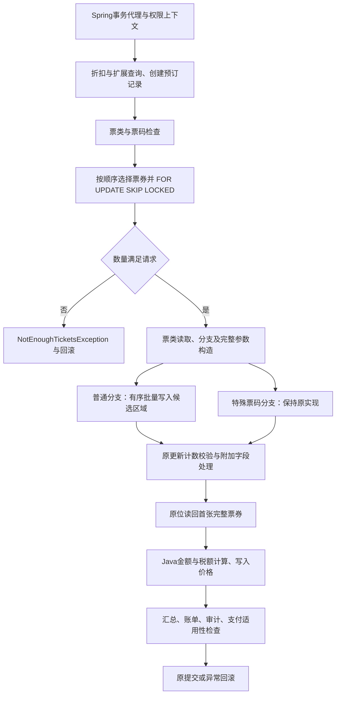

# alf.io 预订依赖与一个待验证的融合候选

后续进展：[原路径批量写入契约已完成小规模验证](ALFIO_BATCH_CONTRACT.md)。候选仍未实施或准入；以下保留本轮依赖观测的原始范围。

2026-11-06。完成一次原版固定回放的依赖观测，**新增观测后的53份结果与上轮原版完全一致**。从字节码提取调用／注解事实，并记录实际数据库语句顺序；本轮不修改业务实现，不优化或测性能。

原先考虑的“批量写入＋立即读回首张票”范围过宽：两者之间确实执行附加字段处理。当前只保留一个更窄的候选：**普通预订分支内部的有序批量写入专化**，状态为 `proposed_not_admitted`，尚未允许替换原路径。

## 恢复了什么，尚未证明什么

输入为锁定官方JAR的字节码和随包依赖。提取器读取6个指定业务／配置类及Repository包中的相关class，共51个class条目，得到762个SQL注解条目。预订创建入口在同一管理器内部连同lambda实现句柄展开，涉及33个方法、397条调用／句柄边；其他模块保持显式边界。

提取事实包括方法描述符、调用指令、lambda bootstrap目标、分支跳转位置、`@Query`、参数 `@Bind`、`@Transactional` 和 `@EventListener`。这些是字节码事实，不自动等于完整值依赖、控制条件、别名或异常效果证明。当前没有把整个静态调用图宣称为DAG；按单次执行语句顺序得到的图才是有向无环的事件序列。

动态侧沿用上轮完整夹具与共同时间／UUID控制，重放同一12步。通过独立观察连接写入操作标记，PostgreSQL JSON日志保留真实应用连接的语句及参数，排除观察连接的全表扫描。得到244条语句记录：220条业务SQL、12次BEGIN、11次COMMIT及1次ROLLBACK。

220条业务SQL都能找到SQL注解匹配，其中40条存在多个匹配方法，例如返回实体或Optional的方法共用同一SQL。匹配只统一绑定占位符和展开列表的形状，保留字符串字面量；**它是连接静态与动态证据的线索，不是逐次观测到代理所选方法的证明**。歧义保留，未用于删除授权。

762个注解中未被本次路径覆盖的部分不视为无用。原版的其他能力、模块与数据保持完整。

## 预订创建的主要执行关系

下图是经字节码和语句轨迹核对后的人工摘要，不是完整自动效果图：

取消路径还有独立的 `CleanupReservations → EventReservationManager.cleanupReservations` 事件边，以及后续等待队列处理对RELEASED→FREE的转换。这些由注解与既有执行证据共同支撑，继续保留，不纳入本轮融合区域。

## 实际发现的阻断点

| 原有成功预订 | 批量UPDATE的服务端执行数 | 首票读回前的附加字段查询 | 证据位置 |
|---|---:|---:|---|
| 3张票 | 3 | 6 | sql9–sql11 → sql12–sql17 → sql18 |
| 2张票 | 2 | 4 | sql69–sql70 → sql71–sql74 → sql75 |
| 1张票 | 1 | 2 | sql187 → sql188–sql189 → sql190 |

中间每张票都会查询附加字段配置及已有值。当前夹具相关表为空，只说明本批返回为空；不意味着可以删除查询、跳过附加字段能力或把首票读取提前。该中间处理在一般输入下还可能写入字段值或失败。当前没有证明这些效果与票券读取可交换，因此较宽的写入＋读回融合不准入。

超额预订路径仅有8条服务端记录：在锁定选择后抛错并回滚，没有到达批量写入区域。这条错误路径保持原位。

## 唯一保留的候选：有序批量写入专化

候选边界为 `TicketRepository.reserveTickets` 的普通票券分支。当前代码先按票券顺序选取参会人、保留其完整联系信息和元数据，再构造 `MapSqlParameterSource[]`，通过固定UPDATE模板调用 `batchUpdate`，最后求和并转为Java int返回。

拟研究的变换是把已知模板的通用命名参数／批次调度边界专化为一个类型明确的数据库入口，内部仍按原顺序执行完整更新。Java侧的参会人选择、元数据编码和类型转换在验证前保持原语义。没有附加字段数据、票券或字段可以因当前夹具未使用而被剪掉。

设输入为有序参数行序列 (P=(p_1,\ldots,p_n))，每行包含原12项绑定：预订ID、票券ID、票类、语言、源价格、货币、完整元数据、姓名、邮箱、VAT状态等。原更新序列为：

\[
D_i=U(p_i,D_{i-1}),\qquad
r=\operatorname{JavaInt}\left(\sum_i \operatorname{JavaLong}(c_i)\right)
\]

其中 (c_i) 为原JDBC批次更新计数，求和及收窄转换须与Java行为一致。重复ID、顺序、NULL和空字符串都不能随意合并。新入口在相同外层上下文 (C) 下必须满足：

\[
\operatorname{Obs}(C[B(P)],D_0)
=\operatorname{Obs}(C[F(P)],D_0)
\]

观察包含返回值／服务可见异常、完整持久状态、相关序列、事务结局，以及需保留的效果顺序。当前这只是待验证契约，不是已经证明的等价关系。

保留区域外的锁与库存不足检查、更新计数校验、全部附加字段处理、首张票读取、Java价格逻辑、账单、审计、扩展和提交／回滚。特殊票码仍走原路径。候选不依赖具体票券ID、20张票的规模或附加字段表为空。

准入前只解决三组义务：

1. **参数与结果ABI：** 完整字段、NULL、JSON及枚举转换，以及更新计数、`SUCCESS_NO_INFO` 和Java整数转换行为。
2. **效果与错误：** 保留逐行次序、重复ID、触发器／约束效果、调用者权限和RLS；核对异常类别／SQLSTATE与回滚。不能用SECURITY DEFINER绕过权限或加入独立提交。
3. **安全分流：** 不能证明的条件在执行前走旧路径；不得在新路径已写入后再回退重试旧实现。完整差分通过后才考虑性能。

**原实现已经是JDBC batch。** 本轮记录的是服务端执行数，不是客户端往返次数。不能把3条UPDATE宣传成3次网络往返，也不能承诺新入口会更快。可能减少通用绑定和调度开销，也可能因参数编码、数据库函数执行而变慢；无加速同样应保留为迁移结果。

## 产物与下一步

- [字节码提取器](../prototype/alfio/AlfioDependencyExtract.java)、[固定观测脚本](../scripts/trace_alfio_dependencies.py)
- [字节码事实](../evidence/alfio-dependencies/20261106-f8e5aaa63540/bytecode-facts.json)、[调用与SQL执行关系](../evidence/alfio-dependencies/20261106-f8e5aaa63540/dependencies.json)
- [观测前后53文件比较](../evidence/alfio-dependencies/20261106-f8e5aaa63540/comparison.json)、[运行记录](../evidence/alfio-dependencies/20261106-f8e5aaa63540/run.json)、[85文件manifest](../evidence/alfio-dependencies/20261106-f8e5aaa63540/manifest.json)
- [待验证候选契约](../prototype/alfio/ordered_batch_candidate.json)、[三条实际轨迹支持及阻断证据](../evidence/alfio-dependencies/20261106-f8e5aaa63540-candidate/support.json)

一次观测完成，资源已清理。候选只是可审查方案，没有实施。下一步仅针对该区域验证绑定ABI与效果契约，暂不扩大到首票读取、附加字段模块或整个预订事务；不重训模型，不新增性能主张。
