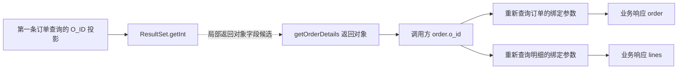

# 从辅助方法结果到业务响应的条件化值路径

2026-11-06。已把上一轮的OrderStatus结果消费线索连接到调用方的业务JSON返回边界：订单ID经局部变量、字段读取进入两条后续查询，再进入响应。承运人和时间这两个中间对象字段没有发现同样的直接值路径，但数据库中的相应列仍由后续查询读取并返回。

28项检查通过，其中包括6次不改源码的真实适配器调用。调用使用严格JDBC边界替身提供结果，不执行数据库；没有新增概率模型、风险规则、数据裁剪或模块删除。

## 恢复方法

复用已有按方法源码SHA-256绑定的反射桥契约，通过原类型化提取器重新解析调用目标，本批得到22个已验证桥调用结果。新提取器从这些结果出发，跟踪声明身份明确的局部变量、类型转换、字段读取及返回表达式。

仅为三个API提供显式的“可能影响返回值”摘要：

- `AppRuntime.rows`的查询及绑定参数可能影响所返回的行。
- `JSONArray.getJSONObject`可能从接收者选择返回分量。
- 新建对象上的连式`JSONObject.put`可能把接收者及参数值带入返回对象。

这些摘要不是所有外部调用的默认规则。一般调用保持不透明，不擅自将全部实参连到返回值。重赋值局部变量、局部可变JSON对象、检测到的字段写入或对象逃逸、重复JSON键等保留未知或停止已支持的值路径。字段别名、外部副作用、解码异常及全程序控制并未证明完备。

显式丢弃调用结果会另记`discarded_call_value`，并始终保留调用执行效果。没有值路径不能直接推出没有写入、异常或其他可观察影响。

## OrderStatus的实际连接

从已有三个getter／返回字段候选中，只有`Oorder.o_id`在当前调用方找到通往业务响应的条件化值路径。运行时核验两条后续查询的第2个绑定参数：基准为101，改变中间订单ID后均变为202，最终响应订单及明细的订单号随之改变。

`o_carrier_id`和`o_entry_d`未通过这个中间对象参与响应构建。**这不意味着数据库中的承运人和时间列无用：后续`SELECT * FROM oorder ...`仍读取并返回它们，必须保留。** 本轮定位的是特定中间值的消费关系，没有定义数据库字段的保留边界。

`getOrderLines`的返回列表被调用方丢弃；响应的`lines`来自另一条重新查询。这只说明该次返回值不直接进入业务JSON，不说明调用可以直接删除。

## 实际调用验证

重新编译未修改的冻结适配器和反编译OrderStatus，确认实际加载这两个类。测试在JDBC返回边界注入中间值变化，并保持后续查询回复的约定不变；它是调用方数据流实验，不是改变数据库记录的实验，也不模拟一致快照或SQL执行。

| 输入扰动 | 实际业务结果 |
| --- | --- |
| 基准中间订单ID 101 | 返回订单101及其明细 |
| 中间订单ID改为202 | 后续两条查询参数变为202，响应改变 |
| 仅中间承运人3改99 | 响应不变，后续重新读取仍返回3 |
| 仅中间时间改为另一时间 | 响应不变，后续重新读取仍返回原时间 |
| 被丢弃的明细计算所读商品10改999 | 响应不变，返回的lines仍来自另一次查询 |
| 被丢弃的明细查询抛出SQLSTATE 58000 | 异常传播，无法构建正常业务响应 |

逐调用事件确认这些扰动确实被getter读到，六个版本也都实际执行了被丢弃返回值的明细查询。后一个反例防止把“返回值不用”偷换成“代码无影响”。

10个静态控制包含直接值、改名、标量别名、字段读取、重赋值、字段覆盖、对象逃逸、局部可变JSON、重复键和丢弃返回值。未支持结构没有获得安全结论。总计28项驱动检查及37个证据文件SHA-256核验通过。

## 与核心问题的关系

分析现在可以区分三件事：

1. 某个查询返回值的哪些部分进入了调用方支持的值路径。
2. 哪些数据库列虽然对应中间值未被消费，仍通过其他查询参与响应。
3. 哪些调用的返回值虽然被丢弃，执行本身仍可能影响结果或异常。

这使后续候选评估可以围绕具体值路径与调用效果展开，避免依据有限样本删除数据，或仅凭返回值不用就删除调用。是否可融合、替换或删除仍需明确能力契约和独立验证，本轮没有作此决定。

当前闭合的是条件化的**业务响应构建边界**`TpccApp.reference`。上轮getter到返回对象字段仍是候选关系，未证明任意别名、字段覆盖或finally行为；本轮没有运行AppRuntime事务／状态包装、完整数据库或并发语义，也没有完成任意程序的端到端等价证明。所有已使用模块仍是开发材料，不能称为新的独立泛化测试。

## 实现与证据

- [调用方提取器](../prototype/module_pruning/CallerValueExtract.java)、[适配器边界探针](../prototype/module_pruning/CallerObservationProbe.java)、[固定验证驱动](../scripts/test_caller_observation.py)。复现：`python3 -B scripts/test_caller_observation.py`。
- [协议](../evidence/caller-observation/20261106-a24d139b2f00/protocol.json)、[类型化调用目标](../evidence/caller-observation/20261106-a24d139b2f00/calls.json)、[调用方值图](../evidence/caller-observation/20261106-a24d139b2f00/caller.json)。
- [拼接到响应的路径](../evidence/caller-observation/20261106-a24d139b2f00/response-routes.json)、[执行前冻结](../evidence/caller-observation/20261106-a24d139b2f00/before-probe-freeze.json)、[六次调用及事件](../evidence/caller-observation/20261106-a24d139b2f00/probe.json)。
- [检查报告](../evidence/caller-observation/20261106-a24d139b2f00/report.json)、[哈希清单](../evidence/caller-observation/20261106-a24d139b2f00/manifest.json)。
