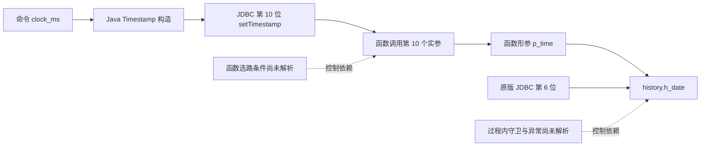

# 跨 Java、JDBC 与 SQL 的依赖图恢复

2026-11-05。首轮小验证完成。自动恢复了 Payment 的“原 JDBC 第 6 位 → history.h_date”和“融合 JDBC 第 10 位 → 函数第 10 个形参 → history.h_date”对应关系；没有向算法提供这组位置映射。NewOrder 的配置选路尚未闭合，明确保留未知。

24 项固定图／映射检查通过，扩展后的 AST 提取器仍通过原来的 22 项边界检查。本轮没有数据库执行、计时、数据裁剪或自动模块删除。

后续状态：NewOrder 的白名单守卫现已支持局部目标收窄，见[控制依赖恢复](GUARDED_DISPATCH_RECOVERY.md)。下文保留首轮的未知边界。

## 如何自动发现依赖

依赖恢复从程序结构开始，日志只提供某次执行的补充证据。没有出现在日志中的边不能直接删除。

1. **Java 值和语句对象。** 使用 javac 带类型归属的 AST 识别参数、取值、转换、setter、PreparedStatement 声明与执行位置。通过声明身份连接 prepareStatement 与相应 setter，避免把两个同名局部变量当成同一语句对象。
2. **跨 JDBC 边界。** 从实际 prepareStatement 字符串恢复 SQL。对常量、字符串拼接、有限三元分支，以及明确的 SQLStmt API 摘要作有限展开；动态配置、重赋值或未知调用保留未知。实际 JDBC 占位符次序决定实参位置。
3. **SQL 参数到数据效果。** 从函数定义取得形参顺序，连接调用实参与形参；从显式 INSERT 列列表和 VALUES 表达式连接最终写入列。根据实际使用匹配，不根据参数名字相似或类型相同猜测。
4. **区分数据边与控制边。** 值传递、实参传递、写入列是不同的边。无法解析的函数选路和过程控制仍作为节点连接到相关操作。本轮记录“可能写入”，没有把两个分支当作必然连续执行。
5. **有环图再压缩成 DAG。** 原始依赖图可以有环。用强连通分量把互相可达的节点压缩为一个节点，得到 DAG；原节点、原边及循环标记全部保留。不能为了得到 DAG 而删除循环边。

当前实际提取的是时间写入的局部数据切片，不是整个应用完整调用图。SCC 实现有互递归和自递归图控制例，但本轮没有自动恢复真实 Java 递归调用。

## 实际恢复结果

原版 SQL 是八列 history INSERT，时间位于第 6 个占位符。融合入口有十二个函数参数，时间位于第 10 位；函数中的 INSERT 又把该形参放回 history 的第 6 个值。分析器通过这两层位置关系自动连接它们，输出按实际数据库列聚合的结构对应候选。

Payment 的函数名来自三元表达式，包含正常和故障诊断两个静态目标。两条路径均被保留，分别连接各自函数形参与同一个目标列；没有因为当前正常运行只使用一个目标就删除另一个。

NewOrder 的函数名包含 System.getProperty 读取的 mode，并在后续进行白名单检查。现有字符串分析没有把该守卫收窄为有限目标集合，因此保留 unknown_dependency，未把 SQL 文件中存在的 neworder_full 强行当成唯一目标。这是控制依赖与配置域分析的具体待解决点。

## 验证与拒绝边界

| 控制例 | 结果 |
| --- | --- |
| 重命名函数、重命名形参 | 仍恢复相同写入列 |
| 同时调整 INSERT 列与值的顺序 | 对应关系不变 |
| 只交换目标列，不交换值 | 原 history.h_date 对应消失，显示新的目标列 |
| 错误 JDBC 参数位置 | 不沿用旧的时间列对应 |
| 缺失函数体、重复／重载定义 | 未知 |
| 形参重新赋值、动态 SQL | 未知，不声称直通写入 |
| 未解析的 Java SQL 字符串 | 保留未知节点与来源，不虚构调用目标 |
| 注释或字符串中出现 SQL／函数文本 | 不产生真实写入或可调用声明 |
| 互递归、自递归图 | 压缩后无环，原循环成员与边仍保留 |

实际原版恢复两条时间 INSERT 路径；候选恢复 Payment 两条可能路径，并保留 NewOrder 一项未知。结构对应仅说明“这些值最终指向同一列”，不证明写入次数、到达条件、提交结果或值语义相同。此前的边界契约和端到端验证继续提供其他层面的证据，不能互相替代。

第一次检查记录 [20261105-123fb5c38043](../evidence/cross-layer-dependencies/20261105-123fb5c38043/run.json)保留：发现限定名称拼接错误，并暴露了对 NewOrder 配置选路可解析性的过强预期。修复名称解析后，没有扩大分析器去猜配置目标，而是把该路径纳入未知检查。最终检查范围冻结，没有追加业务测试。

## 仍然依赖的前提

- SQLStmt 构造和 Procedure.getPreparedStatement 采用显式 API 摘要。Payment 的 SQLStmt 字段不是 final；恢复使用其声明初始化值，外部替换字段的可能性仍记录为前提，未证明封闭世界。
- SQL 分析器是受限语法：明确列列表的单行 INSERT、受支持的函数参数和直接形参写入。复杂表达式、动态 SQL、重载目标和参数重写不自动放行。
- 表名解析使用当前固定的 public schema／search_path 前提，没有替代数据库目录解析。
- 过程控制记录为未解析控制节点，而非精确控制依赖图；未恢复异常、别名或全部表读写的完备关系。
- 原版静态切片看到的是系统时钟构造，运行时冻结时钟替换仍由此前明确的运行时契约描述。本轮只自动恢复目标对应，不擅自合并两种值来源。

因此图输出始终标记 automatic_deletion_authorized=false。它用于指导下一步分析和审核，不能凭图上没有某条已知边就宣布模块无用。

## 产物与复现

- [AST 提取器](../prototype/module_pruning/JdbcBoundaryExtract.java)：新增 JDBC 语句工厂及有限 SQL 字符串集合提取。
- [图恢复与 SCC 实现](../scripts/cross_layer_dependencies.py)、[固定验证驱动](../scripts/test_cross_layer_dependencies.py)。
- [最终报告](../evidence/cross-layer-dependencies/20261105-24eab84fe4bd/run.json)、[原版图](../evidence/cross-layer-dependencies/20261105-24eab84fe4bd/original-graph.json)、[候选图及压缩 DAG](../evidence/cross-layer-dependencies/20261105-24eab84fe4bd/candidate-graph.json)、[自动对应结果](../evidence/cross-layer-dependencies/20261105-24eab84fe4bd/correspondence.json)。
- [AST 回归及本轮实际提取事实](../evidence/jdbc-boundary-contracts/20261105-a7de7fb82bc7/run.json)。

运行 `python3 -B scripts/test_cross_layer_dependencies.py` 复核冻结 v2 AST 事实与实际 SQL 的图恢复，归档中保留该提取器版本。当前 v3 守卫扩展使用 `python3 -B scripts/test_guarded_dispatch.py` 验证；`python3 -B scripts/test_jdbc_boundary_contracts.py` 可重新执行 AST 提取及原有边界控制。均不需要 Docker。

本阶段的推进是把一条原本手工指定的跨语言参数对应变成可追溯的自动数据流关联。AST、位置映射和 SCC 都是已有基础方法；研究贡献仍需通过更多跨模块变换与独立案例来评价。本轮收敛于这个小验证，不立即扩展完整静态分析平台。
