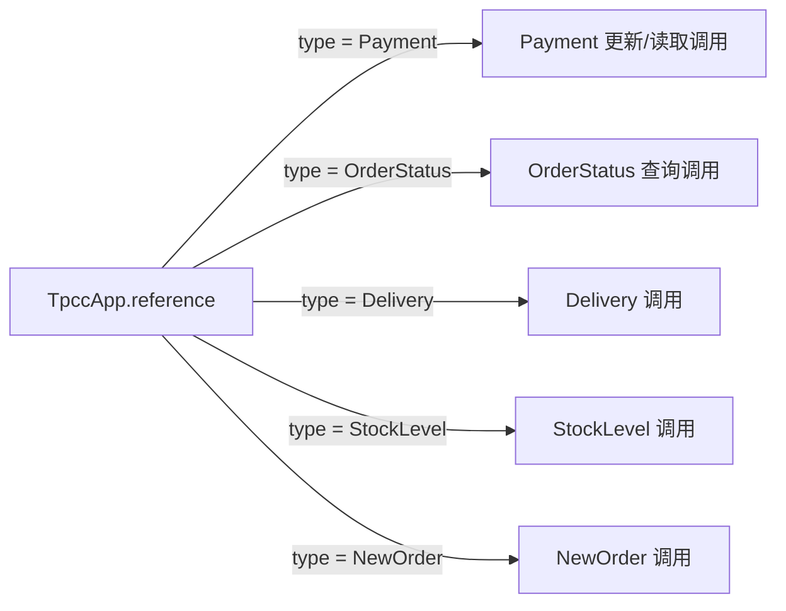

# 调用边的必要条件与路径排除

2026-11-05。第一版条件分析已实现：**从 Java 源码给调用边附上必要的分支条件，检查这些条件在声明上下文中是否矛盾。** 这比无条件可达图多了一层区分，但尚不是全程序路径求解器，也不把静态可行当作实际执行。

本轮继续使用冻结的反编译 OrderStatus 和原始适配器 TpccApp。程序、业务数据与功能选项未改变；没有运行应用、数据库或计时，没有新增删除候选或拟合模型。

## 判定的含义

对某个调用位置 e，从源码提取必要条件 N(e)，明确的上下文约束为 C。仅当 `C ∧ N(e)` 不可满足时，才能排除**该上下文中的这个调用位置**。

| 输出 | 含义 | 图中的处理 |
|---|---|---|
| `excluded_by_necessary_guards` | 已表示的必要条件有矛盾 | 在该上下文的诊断投影中排除对应边，保存来源和矛盾依据 |
| `not_refuted` | 支持的必要条件可以同时成立 | 保留；不代表完整路径可行，更不代表实际执行 |
| `unknown` | 条件缺失，或存在不支持的控制 | 保留 |

未求解的控制不能填成 false。不过，若已经可靠提取的必要条件本身矛盾，即使同时存在其他未知条件，该调用位置仍可排除。例如 `enabled ∧ ¬enabled ∧ unknown` 不可能成立。条件变量必须满足本轮的稳定性要求。

一个模块若有多个调用位置，排除其中一条边不会排除其他边。全局模块删除还需所有保留入口、外部调用及效果义务闭合；本轮始终 `deletion_authorized=false`。

## 支持范围与来源绑定

- 布尔局部变量/参数及逻辑非；字符串 `equals` 常量比较，支持常量在接收端或参数端。
- 字符串箭头 `switch`，包括多个常量标签和 default 排除集合。不支持贯穿或带 guard/pattern 的分支。
- 合取嵌套分支的条件，用声明位置、方法作用域和编译器符号区分变量。同名变量不合并，不按业务字段名称写死规则。
- 变量在所分析源码中任何位置被赋值，都拒绝用其缩窄条件，哪怕赋值发生在调用之后。字段、可变对象属性、String 的 `==`、复杂表达式等保持未知。
- 跨 lambda 边界不继承外层条件；循环、异常控制、短路表达式、三元表达式等未求解控制记录为未知。条件求值本身的调用仍保留，不能因为分支体不可行就删掉求值或异常效果。

提取器给普通调用、构造调用和已识别效果附条件；反射目标、SQL 定义引用及调用效果义务继承同一调用位置的条件。初始化关系保持已有保守处理。

求解器只处理布尔/字符串集合约束的交与排除。字符串默认域不收窄为出现过的常量，default 仍允许其他字符串；没有取样业务值。上下文通过声明 ID 绑定，未知 ID、类型错误或空能力域拒绝分析，避免用错误配置产生真空等价结论。

当前只合取**单个调用位置所在方法内的词法祖先条件**。不跨方法拼接同名变量，不做实参替换，也不把递归多次调用中的局部状态当成同一状态。返回后的控制约束、堆状态、完整 CFG/SSA 和跨过程路径仍未建模。

## 真实应用上的结果

以下调用位置的条件由源码自动提取，不来自执行日志或测试数据：



图是五类调用条件的示意，不是完整动态轨迹。例如付款中的客户信用条件、Delivery 的循环以及外部数据库效果仍有未知项。

| 分析视图 | 未被排除的已支持边 | 未知边 | 条件矛盾排除边 |
|---|---:|---:|---:|
| 保留全部能力，不约束事务类型 | 190 | 320 | 0 |
| 仅查看 `type = OrderStatus` 的诊断视图 | 84 | 267 | 159 |

共 337 个节点、510 条边。表中统计的是边记录，包含调用、反射目标、效果义务等，**不是独立调用次数、删除模块数量或运行成本**。两个视图都保留全部源节点。

第二个视图仅验证条件分析是否能区分事务分支，`contract_adopted=false`；它没有成为应用能力限制，也没有关闭 Payment/Delivery 等功能。不能用它的 159 条条件排除边声称完整应用获得了删减或加速。全部能力视图没有发现新的不可行调用位置，保持原图。

已有 `getOrderLines` 调用在全部能力视图中仍可达，在 OrderStatus 诊断视图中也未被排除。因此不能靠“返回值被丢弃”把这条执行依赖消掉。

## 有界验证

新增 Java 结构夹具包含 17 个 `hit()` 调用位置，四个被排除：布尔相反条件、字符串相反值、switch 标签与嵌套字符串条件冲突，以及已证明冲突外再包一个未知条件。它们是源码结构验证，不是新增真实应用标签。

另外检查了可变参数、后续赋值、可变字段、贯穿 switch、循环、异常控制、字符串身份比较、延迟执行及多分支保留；字符串比较的求值调用在分支体被排除时仍被保留。

- **24 项源码/真实图检查通过。** 包括变量声明绑定、完整能力不删边、诊断视图区分事务、全部节点保留及展示调用可达。
- **5 项条件求解单元检查通过。** 其中用 64 组双布尔谓词组合，与每组四个赋值的穷举判定对照；这是算法的有限域检查，不限制业务数据。另覆盖未知传播、无限字符串域、类型/上下文拒绝、同名作用域及多条调用边。
- **6 项 DAG 检查通过。** 同一套检查重复运行不增加样本数。
- **37 项旧提取检查、18 项构造/初始化检查通过。** 确认新增条件元数据未破坏原有来源、构造和入口关系。

本轮结束于“静态边 → 源码必要条件 → 有界矛盾排除”。未实现动态引用追踪、完整跨过程可行性证明或代码删除；未测性能。

## 产物与复现

- [完整报告](../evidence/module-call-conditions/20261105-92bf37d367f7/report.json)、[提取事实](../evidence/module-call-conditions/20261105-92bf37d367f7/extracted.json)、[17 个结构位置的条件与判定](../evidence/module-call-conditions/20261105-92bf37d367f7/fixture-results.json)
- [全部能力视图](../evidence/module-call-conditions/20261105-92bf37d367f7/full-capability-analysis.json)、[全部能力 DAG](../evidence/module-call-conditions/20261105-92bf37d367f7/full-capability-dag.json)、[OrderStatus 诊断视图](../evidence/module-call-conditions/20261105-92bf37d367f7/orderstatus-diagnostic-view.json)
- [37 项提取回归](../evidence/module-extraction/20261104-2bf9e22a2327/analysis.json)、[18 项初始化回归](../evidence/module-initialization/20261105-ca8677bba837/report.json)；前者沿用旧脚本日期前缀，实际为本轮执行。
- [条件求解器](../prototype/module_pruning/path_conditions.py)、[Java 提取器](../prototype/module_pruning/DependencyExtract.java)、[有界验证入口](../scripts/analyze_call_conditions.py)、[冻结输入与摘要](../evidence/module-call-conditions/20261105-92bf37d367f7/manifest.json)

```sh
python3 -B scripts/analyze_call_conditions.py
```

命令只做静态提取、图分析和结构检查，不运行应用或数据库。
