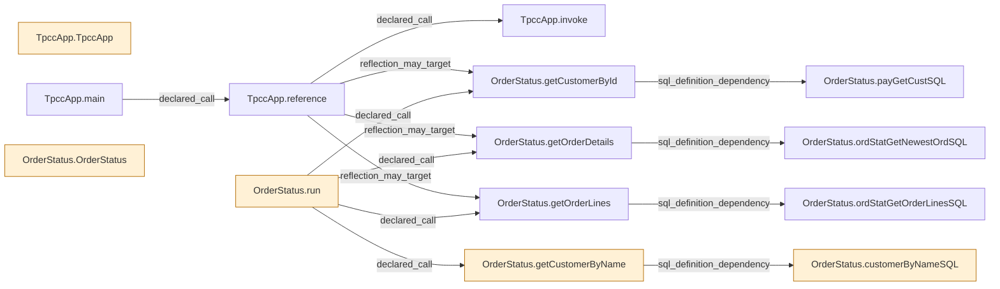

# 从反编译证据生成调用 DAG

后续已完成[构造与初始化补边及入口对照](MODULE_INITIALIZATION_DAG.md)。下面保留第一版的范围和结果；最新图为 337 节点/510 边，生成脚本默认使用新的冻结提取档案。

2026-11-05。已实现第一版调用图及强连通分量压缩，复用冻结 Java 提取结果生成 **294 个节点、439 条边**的来源绑定图。本次没有重新反编译或运行数据库：输入为已反编译的 OrderStatus 和原始应用适配器 TpccApp，其余类仅保留外部符号与未知义务。

节点含方法、SQL 定义、外部符号、初始化占位和效果义务，不代表 294 个业务模块。本例未发现已表示边构成的环；递归场景在结构测试中验证。五项检查通过，未删除代码或数据。

## “不在链路上”的精确定义

先声明所有保留入口 R，包括 API、后台任务、回调、构造/初始化等需要保留的触发点。建立保守的可能调用/依赖图 G；递归调用组成强连通分量，合并后得到 DAG。所有可能目标都进入图，不根据调用频率或测试样本选目标。

```text
K = 从 R 沿所有可能依赖边可达的节点集合
U = G 的节点集合 − K
```

K 中的节点先保留；U 是结构上的筛选范围。只有图对声明契约完整、入口完整、隐式效果与构建边界闭合后，U 才能成为删除候选。有未知边时，不能把 U 当作已经证明不可达。

这个定义针对执行可达性。若模块仍被调用，只是结果没有用途，它仍属于 K；想去掉这类工作，需要进一步依据保留输出、状态、异常与资源效果做需求切片。两个问题不能混为一个“调用 DAG”。

## 实际图包含什么

- 默认入口为应用 `TpccApp.main`，覆盖适配器中的原有事务分支，不按某次请求只保留 OrderStatus。为保守处理初始化，额外保留两个源文件级初始化根。
- 直接调用、编译器解析的声明目标、已知反射候选、SQL 定义依赖均保留来源位置。反射候选继续依赖旧档案中人工审阅且绑定哈希的桥接摘要，不冒充完全自动分析。
- `discarded` 返回值不会移除调用边。显式抛错、可能堆写入作为效果义务节点，外部调用/未闭合虚分派作为未知节点。
- 限定两份真实输入，分析器的独立 Java 夹具不进入应用图。外部类体、构造边、动态分派和所有隐式异常尚未补全；效果节点目前是义务记录，尚不是完整的输出反向切片。
- 输出每个分量的成员、DAG 边、拓扑序和一条入口到节点的前驱见证；完整边仍保存在原图，方便返回源位置检查。

下面是已有源码方法和 SQL 节点的**自动生成投影**，省略外部符号、初始化和效果义务，不能拿这张小图单独批准删除。橙色表示未出现在当前已表示入口路径上，仍属于 unknown。



## 本例得到的判断

14 个内部方法/SQL 节点中，有五个不在当前已表示入口路径中：两个构造方法、原终端 `run`、按姓名找客户的方法及其 SQL 定义。**这五个都没有获准删除。**

两个构造方法尤其说明图的完整性问题：旧提取器没有完整表示 `new` 到构造方法的边，不能将其误报为无用代码。`run` 属于另一个入口；若要保留原终端能力，它必须加入 R。姓名查询的可达性随这个入口而改变。外部反射/框架入口尚未关闭，因此其余图外节点也不能直接移除。

此前有加速的 `getOrderLines` 展示模块仍然可达：`main → reference → 反射目标 getOrderLines → 专属 SQL`。图生成器已检查这条关系没有因为结果被丢弃而丢失。说明单纯删除不可达代码不能复现该例的运行收益；此前收益来自更强的能力/效果契约下取消已执行工作。

当前 DAG 的意义是让保留链路、共享依赖和缺失边可以逐项核对，而不是把图外节点直接视为垃圾。业务数据域、数据库行和字段未被缩减。

## 检查与边界

五项结构检查覆盖：递归分量合并与拓扑序、共享提供者保留、追加入口扩大保留集合、未知节点阻止删除、长链避免递归栈溢出、无效边拒绝、丢弃结果的反射调用与 SQL 依赖保留、堆写入义务、分析夹具隔离。

第一次真实图构建发现效果元数据的 `kind` 与节点类型参数重名，已改为嵌套效果记录并补入检查；失败输入档案保留。修复后的完整构建和冻结版本测试通过，没有重复业务实验。

本阶段完成“已有反编译事实 → 可追溯调用图 → SCC DAG → 入口保留集合”。未实现通用反编译器、完整调用闭包、输出需求切片或自动删除。下一项图完善应优先补构造/初始化边，并明确入口清单；不通过追加概率分数弥补缺失边。

- [实现](../prototype/module_pruning/call_dag.py)、[检查](../prototype/module_pruning/test_call_dag.py)、[生成入口](../scripts/build_module_call_dag.py)
- [构建报告](../evidence/module-call-dag/20261105-581f4f9ee4c0/report.json)
- [带来源的完整图](../evidence/module-call-dag/20261105-581f4f9ee4c0/graph.json)、[DAG 与入口路径](../evidence/module-call-dag/20261105-581f4f9ee4c0/dag.json)、[Graphviz DOT](../evidence/module-call-dag/20261105-581f4f9ee4c0/dag.dot)
- [自动生成的小图](../evidence/module-call-dag/20261105-581f4f9ee4c0/source-projection.mmd)、[测试日志](../evidence/module-call-dag/20261105-581f4f9ee4c0/tests.log)、[冻结输入与哈希](../evidence/module-call-dag/20261105-581f4f9ee4c0/manifest.json)

复现只构建图和运行结构检查，不运行业务或删除模块：

```sh
python3 -B scripts/build_module_call_dag.py
```
