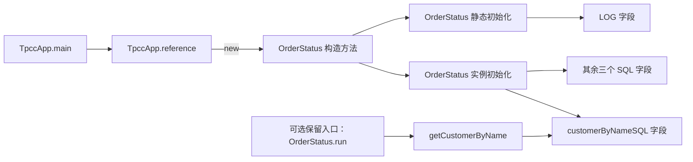

# 构造与初始化依赖补齐

2026-11-05。已在已有 Java 提取器中加入构造目标及类初始化归属，重新生成调用 DAG。**OrderStatus 构造方法从图外恢复为可达；内部方法/SQL 图外节点从五个降到三个。** 本轮修复依赖图，没有删除模块、关闭业务能力或裁剪数据。

输入仍是已反编译的 OrderStatus 与冻结的原始 TpccApp 适配器，没有新反编译或运行应用。其他事务与框架类体不在本次源码分析范围内。

## 新恢复的链路



这是新图的局部说明，不表示执行顺序或次数。`customerByNameSQL` 即使没有从当前应用入口消费其查询值，也仍由对象初始化构造；不能因为查询消费者不在入口链路上就把字段初始化自动判成无用。是否可以再去掉这项初始化，需要单独的效果与构建边界分析。

## 提取规则

1. 使用编译器归属后的符号解析 `new`、`this(...)`、`super(...)`，保存具体构造签名，区分重载和隐式默认构造。
2. 为每个声明类建立静态初始化、实例初始化节点；字段初始化和初始化块中的调用归到对应节点。嵌套类的初始化不归给外层方法。
3. 构造方法连接本类初始化节点，初始化节点连接它定义的字段。这里记录保守依赖，`this` 委托不会被解释成重复执行实例初始化。
4. 构造方法引用 `Box::new` 保留可能目标，但激活时机保持未知；不把创建引用等同于马上构造对象。
5. 匿名类、局部类的构造目标保持 unknown，避免把不稳定身份当成完整绑定。两类初始化身份也标为不完整。

当前仍把所选源码中各类的静态初始化节点作为保守根。这可能保留多余节点，但避免因未建模的静态访问触发而漏掉效果。旧提取档案仍可使用文件级初始化占位节点，不把旧数据冒充新证据。

## 保留入口的对照

入口是明确提供的分析输入，不是自动发现的全应用清单，也不表示已经授权放弃某项产品能力。

| 分析画像 | 保留入口 | 当前图外的内部方法/SQL 节点 |
|---|---|---|
| 现有应用 | `TpccApp.main` ＋保守静态初始化根 | `TpccApp()`、`OrderStatus.run`、`getCustomerByName` |
| 应用与原终端 | 上述入口再加 `OrderStatus.run` | `TpccApp()` |

第二种画像只增加保留集合，没有丢失第一种画像的任何可达节点。它确认按姓名查询的保留关系确实取决于终端入口，不能由测试是否出现某个姓名决定。

`TpccApp.main` 是静态入口，本次源码中没有显式 `new TpccApp()` 路径。因此其构造方法仍在图外，并非继续遗漏同一条构造边。但外部反射、框架调用和构建约束未闭合，**两个画像均没有删除授权**。外部类体、虚分派、隐式异常及局部/匿名类型仍保留未知。

## 检查与结果

- 原有提取回归 **37 项通过**，包含反射桥、分支上下文、SQL 形状与拒绝条件；未改变旧反射规则。
- 新增构造/初始化及真实入口关系 **18 项检查通过**：重载、默认构造、`this`/`super`、构造引用、匿名/局部类拒绝、静态/实例块归属、嵌套归属、真实构造可达、SQL 初始化依赖、静态 main 不隐含实例创建、夹具隔离、入口扩展及禁止删除。
- DAG 的 **6 项单元检查通过**，新增“初始化字段即使无读取消费者也保持可达”的检查，并确认未构造类的实例初始化不会仅因静态初始化根而被连接。重复执行相同六项不增加测试数量。

最终图为 **337 个节点、510 条边**，包含外部符号、字段、初始化与未知效果节点；本例已表示边没有递归环。节点数量增加来自补边和表达粒度变化，不是新增业务功能，也不是性能结果。

业务输入、数据和模型未变。本轮无应用/数据库执行、模型拟合或代码删除，检查不构成全程序等价证明。此前的 OrderStatus 展示方法仍然可达，丢弃其返回值仍不导致调用边消失。

## 产物与边界

- [初始化提取报告](../evidence/module-initialization/20261105-9b9711eca669/report.json)、[逐条构造与初始化事实](../evidence/module-initialization/20261105-9b9711eca669/extracted.json)
- [两种入口画像及未闭合项](../evidence/module-initialization/20261105-9b9711eca669/entry-review.json)
- [新图构建报告](../evidence/module-call-dag/20261105-f1307ab3bd87/report.json)、[完整来源图](../evidence/module-call-dag/20261105-f1307ab3bd87/graph.json)、[SCC DAG 与可达见证](../evidence/module-call-dag/20261105-f1307ab3bd87/dag.json)、[自动生成的源码投影](../evidence/module-call-dag/20261105-f1307ab3bd87/source-projection.mmd)
- [37 项旧回归](../evidence/module-extraction/20261104-8ba6745db0de/analysis.json)：归档目录沿用历史脚本的日期前缀，实际为本轮执行，未更改历史档案。
- [提取器](../prototype/module_pruning/DependencyExtract.java)、[初始化结构夹具](../prototype/module_pruning/InitializationFixture.java)、[提取与检查入口](../scripts/extract_initialization_dependencies.py)、[图构建入口](../scripts/build_module_call_dag.py)

本阶段完成构造/初始化缺边修复与入口对照，到此结束。之后若讨论图外删除，应先处理明确目标模块的外部入口和构建义务，不继续靠扩大测试数据证明“没有调用”。

复现只运行静态提取与结构检查：

```sh
python3 -B scripts/extract_initialization_dependencies.py
python3 -B scripts/build_module_call_dag.py
```

第二条默认使用本轮冻结提取档案。若要使用第一条产生的新档案，显式传入 `--source-extraction evidence/module-initialization/<新档案目录>`。
