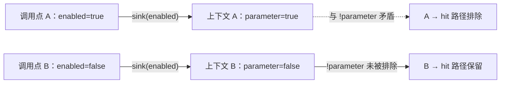

# 跨一个方法边界的条件组合

2026-11-05。已实现第一版**调用方条件 → 实参/形参映射 → 被调用方法内部条件**分析。新增结构夹具的 16 个目标调用上下文中，5 个条件矛盾、4 个未被排除、7 个保持未知。源码检查 19 项和单元检查 4 项通过；上一阶段的条件分析与 DAG 回归通过。

本轮结果以具体调用位置对为单位，不删全局边、不删方法，不改变数据或业务能力。仍是静态必要条件分析，没有观察动态执行。

## 解决的最小问题

```java
static void caller(boolean enabled) {
    if (enabled) sink(enabled);
}
static void sink(boolean parameter) {
    if (!parameter) hit();
}
```

单独看两个方法，各自的条件都能成立。编译器确认实参和形参对应后，在这一调用上下文中得到：

```text
enabled = true
parameter = enabled
parameter = false
⇒ 矛盾
```

因此可排除“这个 caller 位置 → sink 内这个 hit 位置”的组合。若另一个调用方在 `enabled=false` 时调用同一 sink，hit 仍可能执行，不能删除 sink 或 hit，也不能删除共享的全局边。



这个结论覆盖所支持条件下的全部布尔值，不依赖某一批请求是否实际进入过 hit。

## 实现边界

- **目标绑定**：从已归属 Java AST 取得实际方法签名和参数位置，支持源码体可用的 static/private/final 直接目标，区分重载。不根据方法名猜目标。
- **参数传递**：只代入稳定的 Boolean 原始类型或 String 局部变量/参数，以及对应字面量。变量改写、类型不匹配或表达式不支持时保持未知；不从调用日志估计参数值。
- **条件组合**：将调用位置已有的必要条件，与替换后的被调用位置条件合取，复用上一阶段的集合约束判定。String 域仍没有限制为见过的常量。
- **上下文隔离**：每个调用位置单独记录；被调用方法未映射的局部变量使用独立帧身份。不会仅因名称相同就与调用方变量合并。两个形参映射到同一实参时，会保留这一相等关系。
- **拒绝范围**：动态分派未闭合、外部方法体、可变参数、反射桥、递归及 lambda 延迟调用均不进行这项传递。用已有 SCC 算法识别所表示直接调用图中的递归组；检测到的递归调用上下文保持未知。

这是**一次方法边界的组合**，没有沿任意长路径迭代传播，也没有返回值摘要、堆状态、完整异常效果或递归不动点。未被排除仍不代表完整路径可行；未知分派可能隐藏其他递归或调用关系，因此整图完整性也没有升级。

## 验证结果

| 结构上下文类型 | 结果 |
|---|---|
| 调用方 true，callee 要求 false | 矛盾 |
| 传入 true 字面量，callee 要求 false | 矛盾 |
| 两个形参绑定同一布尔实参，callee 同时要求 true/false | 矛盾 |
| 调用方 String 为 east，callee 要求 west | 矛盾 |
| 布尔重载传入 true，内部要求 false | 矛盾 |
| 相反调用方、false 字面量、不同实参、匹配的字符串重载 | 四个未被排除 |
| 实参改写、形参改写、可变参数、虚调用、延迟调用、递归两种位置 | 七个未知 |

19 项源码检查包含重载签名、相同目标的不同上下文、递归识别、分析夹具隔离和零全局删除。4 项单元检查包含布尔组合对照、字面量与独立局部帧、未知传播、替代上下文保留和递归拒绝。

旧的调用条件分析重新运行：24 项源码/图检查、5 项条件单元检查、6 项 DAG 检查均通过。重复执行没有增加业务样本；源码中的业务程序没有运行。

## 现有真实源码上的限制

在冻结 OrderStatus 与原始适配器的源码中生成 **376 个调用位置对**：375 个未知、1 个未被排除、0 个矛盾排除；另有 200 条所选源码外的方法体边界。

这里遍历所选源文件内的方法，包括尚未作为当前应用根保留的原终端 `run`。因此这些数字是**源码调用对计数，不是从应用入口已证明可达的路径数或动态调用次数**。同一个外层调用会与 callee 的多个内部调用形成多个记录。

主要未知原因是现有反射桥使用可变参数、应用入口通过 lambda 回调，以及虚分派或局部控制仍未闭合。唯一未被排除的记录是原终端 `run → getOrderLines → ArrayList` 构造调用，不表示已证明完整执行，也不带来新删除机会。没有把上述路径强行改写成直接调用以迁就分析器。

全局图、完整数据和功能选项均保留。当前证据支持跨边界参数关系的机制验证，尚不支持真实应用上的新删减或性能收益。

## 产物与停止点

本轮在一次调用边界范围结束。后续若继续，应先决定是否对现有反射桥或回调边建立严格的参数关系摘要，而不是不断加深同一批结构样本的传播层数。本轮没有自动启动该扩展。

- [完整报告](../evidence/module-interprocedural/20261105-6a3d9ef1f01a/report.json)、[带实参/形参来源的提取事实](../evidence/module-interprocedural/20261105-6a3d9ef1f01a/extracted.json)
- [结构上下文及判定](../evidence/module-interprocedural/20261105-6a3d9ef1f01a/fixture-contexts.json)、[真实源码调用对与未知边界](../evidence/module-interprocedural/20261105-6a3d9ef1f01a/application-contexts.json)
- [上一阶段回归](../evidence/module-call-conditions/20261105-4d032b48b838/report.json)
- [分析实现](../prototype/module_pruning/interprocedural_conditions.py)、[检查](../prototype/module_pruning/test_interprocedural_conditions.py)、[Java 夹具](../prototype/module_pruning/InterproceduralFixture.java)、[运行入口](../scripts/analyze_interprocedural_conditions.py)
- [冻结输入和哈希](../evidence/module-interprocedural/20261105-6a3d9ef1f01a/manifest.json)

```sh
python3 -B scripts/analyze_interprocedural_conditions.py
```

命令只执行静态提取、条件分析和结构检查，不运行应用、数据库或删除代码。
