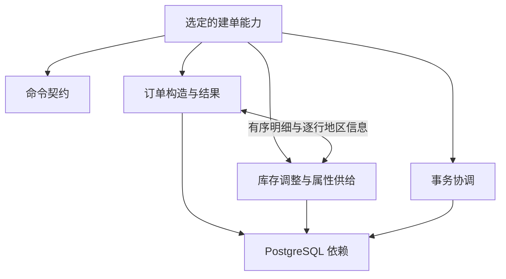

# NewOrder 的能力与模块粒度观察

后续进展：已在实验副本完成[订单与库存职责接口验证](NEWORDER_MODULE_SPLIT.md)。本文保留此前仅观察阶段的事实和划分假设。

2026-11-03。本轮只观察 NewOrder，不改业务实现、不新增干预、不扩展多模块系统。复用已冻结的监控运行 `8729d2283fdc`，选取普通成功、重复商品成功、中途商品无效、数量非法四个例子，并核验相关四个源码快照与当前文件一致。

**能力范围由目标与契约提出，行为记录只提供支持或反例。** 下文的模块是人工提出的逻辑职责，尚未抽取为独立组件，也不是自动恢复的调用图。没有根据未执行路径或未出现数据作任何删除决定。

## 先界定我们想解释的能力

当前研究对象是已约定的单仓库、按客户 ID、串行建单：接收有序订单行，形成订单与明细，更新相关库存，成功结果对应已提交的业务事务；已识别的无效商品导致本次已执行写入撤销。

这是一份分析起点，不是对全部输入和故障的证明。5–15 行、数量 1–10 等是当前应用输入契约；具体回补公式、浮点金额计算、重复商品处理是当前实现规则，是否属于未来产品必须保留的能力仍需业务选择。多仓库属于当前应用明确未支持的范围，不等于对应数据和上游能力没有价值。并发、写入后各类故障、连接中断和其他数据状态保留为尚未验证的条件。

## 四个例子实际说明什么

| 选取记录 | 实际观察 | 能支持的判断 | 不能推出的结论 |
|---|---|---|---|
| new-01 普通成功 | 地区编号更新、订单头/待配送写入；五行读取和两批写入；结果查询后提交 | 当前成功路径跨越订单、库存、结果构造和事务框架 | 所有商品、地区和数据状态都已覆盖 |
| new-05 重复商品 | 商品 6 起始库存 78，数量 1、2 两行后库存 76；累计数量 +3、次数 +2 | 若保持当前规则，模块接口不能随意去重、合并行或改成逐行即时扣库存 | 这种规则就是业务方最终需要的规则 |
| new-07 中途商品无效 | 已执行编号/订单头/待配送写入，随后回滚；两批均未执行，观察前后相等 | 原子性跨越服务与事务调用方，不能只看服务是否抛错 | 已验证库存批次实际写入后的任意失败都可正确处理 |
| new-14 数量非法 | 输入被拒绝，没有对应业务 JDBC trace 和状态观察；静态代码在校验失败后继续下一命令 | 输入契约与业务执行是不同职责，当前此条在业务执行前拒绝 | 其他未采样错误输入或全部校验组合都正确 |

完整例子的来源、输入、SQL 事件索引、边界和状态摘录见[观察数据](../evidence/tpcc-module-observation/20261103-neworder/observations.json)与[原始记录摘录](../evidence/tpcc-module-observation/20261103-neworder/selected-records.json)。SQL 事件提供数据库操作顺序，源码提供调用关系；二者不构成完整动态方法调用图。

## 建议先采用的职责粒度

两个业务职责配合两项横向保障，数据库作为已有依赖整体保留。这些职责目前跨越和共享现有类，划分不要求立刻拆代码。

| 逻辑职责 | 输入、输出和状态 | 必须说明的接口条件 | 当前实现位置 |
|---|---|---|---|
| 命令契约 | 原始命令 → 有效命令或输入拒绝 | 类型、范围、字段集合、明细顺序与重复项；不是证明对象存在 | AppRuntime.validate，CandidateApp 的命令转换 |
| 订单构造与结果 | 客户/地区/有序明细 → 订单 ID、订单头、明细与结果；读客户/仓库、商品价格，写地区编号和订单相关表 | 使用同一事务；价格与金额规则；需要库存侧的逐行地区信息 | NewOrderService 的存在检查、编号/订单/明细部分；CandidateApp.order |
| 库存调整与属性供给 | 同一事务中的地区/有序明细 → 库存更新，以及订单行需要的地区属性 | 行锁与读写时机；行序和重复项；数量/累计字段；不自行提交 | NewOrderService 的 stock 读取、计算、批次部分 |
| 事务协调 | 有效业务执行 → 提交或回滚决定 | 同一连接/事务覆盖相关写入；隔离设置；成功发布在提交后；不同失败路径分开标注 | AppRuntime.run；JDBC/PostgreSQL 提供底层机制 |

PostgreSQL 提供持久化、查询、锁和事务机制，本轮不展开其内部模块，也不据这几条 SQL 限缩数据库全部能力。实际依赖的隔离与事务保证应写入模块契约，不能因串行测试通过而认定锁或隔离机制不需要。

这是职责依赖草图，不是调用时序。监控、状态观察和证据导出属于实验支持层，不能因为实现位于同一个 AppRuntime 类就全部计入建单业务能力。

## 为什么粒度不能直接照搬代码

| 备选粒度 | 优点 | 当前观察到的代价 | 本轮判断 |
|---|---|---|---|
| 整个 NewOrder 或按 Java 类划分 | 容易对应代码和整体验收 | NewOrderService 混合订单/库存；AppRuntime 混合校验、事务与取证；结果构造跨类 | 保留整体能力边界，但类不直接充当职责边界 |
| 按上述职责划分 | 能分别说明状态、接口和保证；保留统一事务 | 订单/库存的 SQL 在同一循环中交织，边界需要显式携带有序明细、地区属性和事务上下文 | 推荐作为下一轮讨论模型，尚未证明拆分后实现成本更低 |
| 每个 if、SQL 或字段分别为模块 | 干预定位直接 | 暴露价格、旧库存、批次、行号、锁及异常等内部状态，接口数量增加；单个回补 if 没有独立业务生命周期 | 作为规则点和观察点，暂不升级为模块 |

若未来某项职责获得独立接口、复用场景或验证要求，可以细分；若切分导致大量内部状态跨边界传递、无法独立维护契约，可以合并。当前选择是一个可修改假设，既不是“最少代码”，也未证明是最优架构。

## 三个需要保留的具体边界问题

**库存还向订单提供数据。** stock.s_dist_XX 被读取并写入 order_line.ol_dist_info。将库存职责简化为“输入购买量，输出剩余量”会漏掉这条依赖。客户和仓库当前虽主要用于存在检查，也仍是前置条件，不能因为未更新它们就说数据无用。[源码](../app/tpcc/src/reversedb/tpcc/NewOrderService.java#L36)

**结果构造目前处于提交之前。** 两个成功例子的操作末尾均为订单行批次、库存批次、订单头查询、明细查询、commit。静态异常处理显示结果查询失败也会进入回滚路径，但本轮没有注入这种失败。因此“把结果查询移动到提交后”涉及契约变化，不能当作天然无害的模块拆分；是否要求保持这种失败行为，需结合目标能力再定。[入口](../app/tpcc/src/reversedb/tpcc/CandidateApp.java#L21)、[事务框架](../app/tpcc/src/reversedb/tpcc/AppRuntime.java#L133)

**观察器本身有数据范围。** AppRuntime.footprint 只观察该地区、该命令商品集合及订单 ID >=3001 的订单。这是固定初始快照的测试设计，不能变成能力的合法订单范围。它没有逐笔观察所有旧订单或整库所有数据；此前九表最终完整摘要提供额外检查，但也不能证明任意数据上的能力完整性。[观察器](../app/tpcc/src/reversedb/tpcc/AppRuntime.java#L76)

## 接下来如何判断这个划分

先讨论两个接口问题，而不扩展系统：

1. 库存职责的契约是否能明确包括“有序明细、重复项规则、地区属性、读写与事务上下文”，且无需让调用方了解全部 SQL 内部变量？
2. 订单职责与事务协调之间，哪些是必须保证的成功/失败语义，哪些只是当前实现的执行顺序？

本轮仅完成观察和映射。未拆分模块、未改业务规则、未删除数据或代码，也未运行新的数据库事务。抽取脚本核验四份源码、冻结文件哈希、成功路径末尾顺序、中止前后状态及输入拒绝的记录缺席；对应[执行证据](../evidence/tpcc-module-observation/20261103-neworder/verification.json)。
