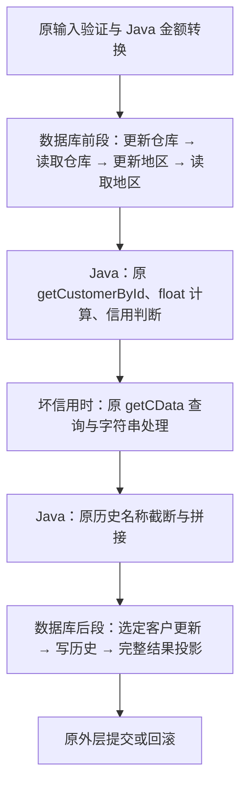

# Payment 分段融合：实现与数据库验证

2026-11-05。固定实验完成，容器与磁盘卷已清理。

后续已加入[契约层的自动边界选择](AUTOMATIC_FUSION_PLACEMENT.md)：在既有语义单元与能力声明上由动态规划选择两段，生成执行代码与本文归档一致。下文保留本轮手工建立区域／类型契约时的运行证据。

Payment 已生成并验证一个分段融合候选：将前后两组数据库操作移入 PostgreSQL，保留中间的原 Java 客户读取、浮点计算、信用判断和字符串处理。普通信用路径的 JDBC execute 从 8 次降到 3 次，坏信用从 9 次降到 4 次。

原版与候选各执行既有 62 条固定命令，响应、业务观察、九表完整状态与不变量一致。五个语义边界用例的双臂真实数据库执行，以及两个故障位置、两个信用分支、两个版本的八次回滚检查全部通过。两个固定 Payment 主体中位耗时下降约 48%～54%；不含提交，不是吞吐结论。

## 执行区域

图中坏信用步骤在普通信用分支跳过。两段函数与中间的原 JDBC 调用共用同一连接、同一个 SERIALIZABLE 事务；数据库函数不提交。WAL、同步提交、行锁和完整业务数据保留。

前段返回仓库和地区名称，通过 JDBC `getString` 接回 Java；原 SQL 中的其他地址字段仍被读取，但不再构造两个只为取得名称的 Java 对象。客户对象继续由原 `getCustomerById` 和 `TPCCUtil.newCustomerFromResults` 创建，保留原字段类型、读取方式及同一对象上的修改。

后段接受 Java 已计算好的字段值和信用判断，恰好执行一条对应的客户更新，再写历史、返回完整的原客户结果投影。坏信用路径中的 C_DATA 查询仍由原 Java 方法执行，没有提前读取、删除或合并其条件分支。

本轮移除了热路径中的多次跨进程边界，未删除 Payment 类文件或整个原 JAR；Payment 的原类仍加载，以执行保留的辅助方法。其他四类事务继续使用原实现，本次候选没有合并先前的 NewOrder 优化，也未切换默认应用。

## 来源与类型边界

[生成器](../scripts/generate_payment_segments.py)复用上一轮带类型的 Payment 提取事实，依 SQL 字段与 JDBC 绑定生成两个数据库函数，并保留来源映射。源码或适配器哈希变化会拒绝。Java 的余额／累计付款／计数修改语句，以及历史名称截断代码，直接复制冻结源码片段。

| 边界值 | 保留的实现 |
| --- | --- |
| 仓库、地区的付款金额 | Java `float` → `BigDecimal.valueOf` → `setBigDecimal` → PostgreSQL numeric |
| 客户余额、累计支付、历史金额 | 原 Java float 计算／值，通过 `setDouble` 拓宽传入；不在 SQL 中重新做金额算术 |
| 客户与历史文本 | 原 Java 拼接及 UTF-16 `substring`，再通过原 JDBC 字符串编码传入 |
| 信用条件 | 原 Java `cust.c_credit.equals("BC")` 的 boolean，后段选择一条更新 |
| 时间 | 原应用固定时钟契约，通过显式 timestamp 参数传入 |

历史名称的纯字符串处理移到了后段调用之前，早于客户 UPDATE。名称来自已经读取的不可变字符串，模式检查确认两个名称列 NOT NULL；这部分计算没有数据库副作用。在本次正常执行、固定时钟、最终事务观察的范围内允许这个移动；不宣称任意错误发生时刻或中间 SQL 轨迹相同。

区域分析器新增一个可选的、由执行后端指定的类型集合，只在这个具体边界契约中承认 JDBC numeric、double、text 和 boolean。默认类型集合未扩大，没有据此允许任意 Java 对象或浮点运算下推。原 NewOrder 图保持一致，原区域分析的 27 项固定回归检查通过。

**切分位置、标量复制与类型契约仍由人工指定。** 通用依赖和区域算法验证这两个已描述的区域，没有自动发现所有安全切点，也没有自动证明 Java 代码等价。上一轮拒绝整段 Payment 下推的结论仍有效。

## 固定验证

[实验驱动](../scripts/test_payment_segments.py)使用锁定的 PostgreSQL 镜像与完整初始快照，在独立磁盘卷上运行。模式准入检查普通表、无用户触发器／规则／RLS、名称非空、正常复制角色及持久化设置。该检查属于实验驱动，不是生产运行时自动回退。

| 检查 | 结果 |
| --- | --- |
| baseline、holdout、transaction_edges、delivery_edges 两臂回放 | 124 条命令；每臂 50 提交、4 中止、8 输入拒绝 |
| 响应、业务观察、九表完整初末状态、五项不变量 | 与冻结基准一致 |
| 非 Payment JDBC 事件 | 与原版一致 |
| Payment 执行数 | 每臂 18 次成功执行；其中 6 次普通信用、12 次坏信用 |
| 这些 Payment 的 JDBC execute 合计 | 156 → 66，减少 90 次 |
| 五个语义边界用例，两臂执行 | 10 次；响应及执行后的九表完整状态一致 |
| 两处故障 × 两信用分支 × 两版本 | 8 次；回滚后九表全部恢复 |

边界用例由上一轮的 Java/JDBC 替身推进到真实 PostgreSQL：

- 余额 10.00 支付 0.01，两个版本都存储 9.99。
- 余额 262144.00 支付 0.01，两个版本都存储 262143.98，保留原浮点链；没有改成十进制直接相减的 262143.99。
- 输入 0.10 的坏信用 C_DATA 仍拼接 `0.1`。
- C_DATA 的 500 个 UTF-16 单元边界保留结尾 `😀`，没有额外保留后面的 `Z`。
- 仓库名截断后的历史文本仍为 `aaaaaaaa😀    district`。

第一处故障发生在前段四步写读完成后、原客户读取之前；第二处发生在客户更新及历史写入之后、结果投影之前。前段已经产生的修改也被外层回滚撤销，说明分段没有把同一事务拆成独立提交。

故障是在对应业务边界注入 SQLSTATE 58000；融合后段的故障还会触发数据库语句级撤销。本轮只比较外层事务结束后的数据恢复，不声称内部异常机制完全相同。未验证并发冲突、任意触发器或所有故障时序。

## 固定计时

[数据库探针](../prototype/module_pruning/PaymentSegmentProbe.java)在同一 JVM、同一数据库中隔离加载两个适配器。两个用例每臂预热三次，随后十个随机臂顺序的测量块，种子 20261105，共 40 个计时调用。各次回滚，夹具设置、完整状态扫描、提交和回滚不计入耗时。

| 固定用例 | 原版中位 ms | 分段融合中位 ms | 下降 | JDBC execute |
| --- | ---: | ---: | ---: | --- |
| 普通信用 gc-small | 2.961 | 1.366 | 53.9% | 8 → 3 |
| 坏信用 bc-text | 3.002 | 1.551 | 48.3% | 9 → 4 |

这是本地 Docker 与带代理观测的事务主体计时，不是整应用端到端、提交延迟或并发吞吐。没有逐层归因协议、驱动、对象物化和数据库计划缓存的贡献；不能将其与 NewOrder 的历史加速百分比相加，也不据此宣称分段方案全局最优。

## 归档与限制

- [固定协议](../evidence/payment-segments/20261105-707221611457/protocol.json)
- [最终运行报告](../evidence/payment-segments/20261105-707221611457/run.json)
- [两个区域及边界契约](../evidence/payment-segments/20261105-707221611457/region-plan.json)
- [生成 SQL](../evidence/payment-segments/20261105-707221611457/generated/install.sql)
- [生成 Java 桥接](../evidence/payment-segments/20261105-707221611457/generated/SegmentedPayment.java)
- [来源映射](../evidence/payment-segments/20261105-707221611457/generated/source-map.json)
- [数据库边界、回滚和计时原始结果](../evidence/payment-segments/20261105-707221611457/probe-results.json)
- [计时摘要](../evidence/payment-segments/20261105-707221611457/timing-summary.json)
- [通用区域回归](../evidence/fusion-regions/20261105-fd9809874cba/run.json)

首次运行在配送场景的类加载断言处停止：该场景不含 Payment，脚本却要求加载候选 Payment 类。修正为按实际执行的事务检查后，按相同协议完成最终运行；候选代码和数据范围未改。首次容器及卷也已清理，[失败记录保留](../evidence/payment-segments/20261105-57e111d8ff54/run.json)，不把重复回放计为额外独立样本。

复现命令：`python3 -B scripts/test_payment_segments.py`，需要本地锁定资产、JDK 和 Docker。固定实验已结束，不为寻求更好数字追加调参。

本轮说明：未知的跨语言语义可以作为执行位置边界保留，同时融合两侧已明确的数据库操作，仍能减少调用并取得局部收益。尚待研究的是如何从这些语义义务自动提出切分，而不是再逐个手写事务后端。
